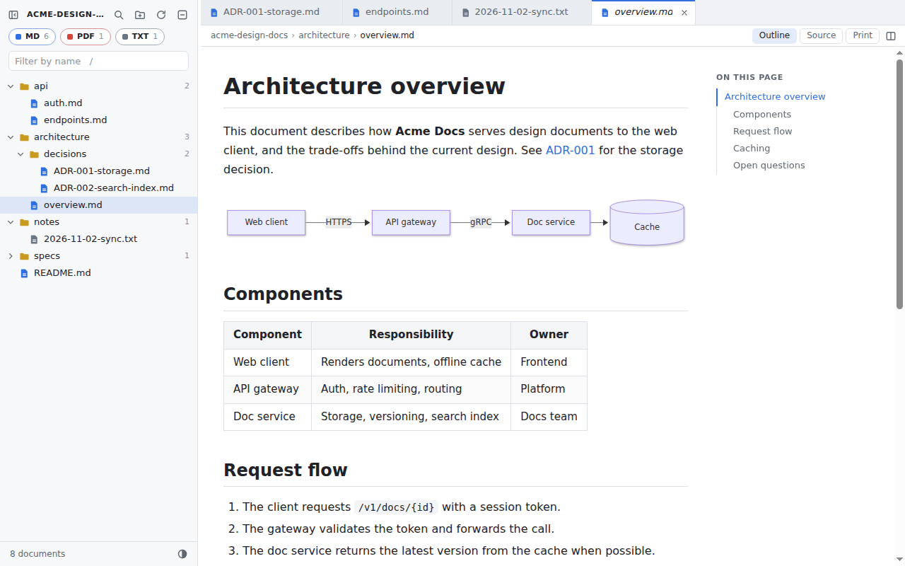

# DocShelf

A calm, offline reader for your **design docs**: Markdown, PDF and plain text, in VS Code-style tabs. It's a Chrome extension. Code files stay out of the way, nothing leaves your computer, and it weighs under 500 KB.



## Why

Editors like VS Code or code-server show every `.py` and `.c` file, and you have to ask for a Markdown preview. DocShelf is made just for reading:

- **One click shows a rendered document.** Double-click keeps it open in a tab.
- **Only documents are listed.** Folders without `.md`, `.pdf` or `.txt` files are hidden.
- **Private:** no network access, no analytics, no accounts. The test suite checks for zero network requests.
- **Light:** no framework and no build step. Libraries load only when a document needs them, and at most 4 documents stay rendered at a time.

## Install (about 1 minute)

DocShelf is free and installed straight from this repository. It's not on the Chrome Web Store.

1. **Download** the latest `docshelf-<version>.zip` from the [Releases page](../../releases) and unzip it somewhere permanent, e.g. `Documents/docshelf`. Or use **Code → Download ZIP**, or `git clone` this repo, and use its `extension/` folder.
2. Open `chrome://extensions` (or `edge://extensions`) and turn on **Developer mode** (top right).
3. Click **Load unpacked** and select the unzipped folder: the one that contains `manifest.json`.
4. Pin the DocShelf icon from the puzzle-piece menu.

**Updating:** download the new zip and unzip it over the old folder (or `git pull`). Then click the reload icon on the DocShelf card in `chrome://extensions`. Your recent folders and settings are kept.

**Good to know:** keep the folder where you put it, because Chrome loads the extension from there. Developer mode only lets you load extensions from your own disk; it doesn't change how Chrome treats websites.

Works in Chrome, Edge and other Chromium browsers (116+). In Brave, first enable `brave://flags/#file-system-access-api`.

## Use

- Click the toolbar icon or press **Alt+Shift+D**, then **Open folder…**
- **Several folders:** every click on the icon opens a new DocShelf tab, and each tab can show a different folder. A reload or a Chrome restart brings each tab's folder back.
- Chrome asks for folder permission again in each new browser session. The big **Reopen "folder"** button makes that one click.

| Key | Action |
|---|---|
| Click / Double-click | Preview (italic tab) / keep open |
| Ctrl+P | Go to a document by name |
| Ctrl+Shift+F | Search inside all Markdown and text files |
| Alt+W · Alt+[ · Alt+] | Close tab · previous · next |
| Right-click | Tab actions (close others, copy path…) and file actions |
| / · Ctrl+B · Ctrl+O | Filter by name · hide sidebar · open another folder |

**Markdown:** tables, task lists, highlighted code with Copy buttons, an "On this page" outline, front matter, images from your folder, and links between docs (`api.md#endpoints` opens in a tab). The **Source** button shows the raw text and **Print** saves as PDF.
**PDF:** Chrome's built-in viewer (pages, zoom, search, print). **Text:** monospace or a readable **Prose** font.
**Live reload:** the open document refreshes when the file changes on disk, handy while you or an AI edit it.

### Docs inside WSL (Windows)

In the folder picker, paste `\\wsl.localhost\<distro>\home\<you>\path\to\docs` into the address bar, or open **Linux** in the left panel. If the picker refuses, map `\\wsl.localhost\<distro>` as a network drive and pick from that.

## Project layout

```
extension/               the extension (load this folder)
  manifest.json          MV3; only permission: activeTab
  background.js          icon click → new workspace tab (reuses an empty New Tab)
  workspace.html, css/
  lib/                   bundled marked, DOMPurify, highlight.js
  src/
    main.js              wiring; folder id lives in the tab URL (?f=…)
    fs/                  types.js (which files count), scanner.js, folderAccess.js
    state/               tabs.js (preview/pinned rules), filters.js
    search/              searchEngine.js (full-text, cached by modification time)
    ui/                  explorer, tabbar, viewerHost, searchPanel, quickOpen, contextMenu, welcome
    viewers/             registry.js (lazy loading), markdown.js, pdf.js, text.js, highlight.js
tools/
  e2e/run.py             headless end-to-end tests (73 checks)
  package.sh             builds the release zip (also done by the release workflow)
  make-icons.mjs         regenerates the icons
docs/screenshots/        README screenshots (regenerate: tools/e2e/run.py --store)
```

**Adding a file type:** add it to `src/fs/types.js` and add a viewer in `src/viewers/registry.js`.
**Edit mode later:** viewers share one contract (`load`, `getViewState`, `setViewState`, `find`, `reveal`, `destroy`). Edit support means adding `enterEdit()`/`save()` and setting `tab.dirty`. The tab store and live reload already respect `dirty`.

## Known limits

- PDF text is not included in Ctrl+Shift+F search.
- In the PDF viewer's title bar, and when downloading from it, the file shows up as a random ID instead of its name, because it is loaded from a local blob URL.
- Mermaid diagrams show as code blocks.

## Contributing

Issues and pull requests are welcome; see [CONTRIBUTING.md](CONTRIBUTING.md). The goal is to stay small, calm and offline.

[MIT License](LICENSE) · [Privacy policy](PRIVACY.md) · [Changelog](CHANGELOG.md)

---

_Made with laziness and, of course, Claude!_
